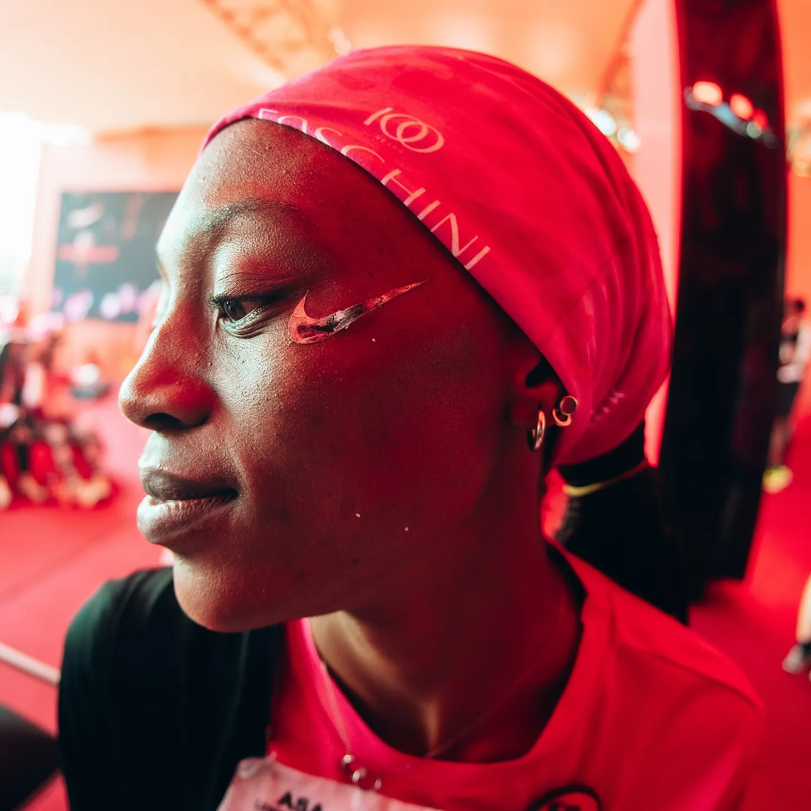

# Remy Shoots — 3D Image Scroll & Optical Fisheye View

A minimal, high-performance web experience replicating the iconic horizontal 3D scrolling gallery, mechanical ticking sound, and optical fisheye / normal lens distortion shader inspired by [Remy Shoots](https://www.remyshoots.co.za/).



## ✨ Features

- **3D Wrapping Infinite Carousel (`Three.js`)**:
  - Horizontal wrap-around carousel with spring/lerp momentum physics.
  - Multi-input control: pointer drag, mobile touch swipe, trackpad/wheel scrub, and keyboard arrow keys (<kbd>←</kbd> / <kbd>→</kbd>).
  - Click-to-center card navigation.
  - Center-focused selective saturation (100% full color at center, monochrome black-and-white for adjacent cards) with subtle UV depth parallax.

- **Optical Fisheye / Normal Lens Shader (`GLSL`)**:
  - Full-screen post-processing pipeline using `CubeCamera` and `WebGLCubeRenderTarget`.
  - Exact optical radial mapping:
    $$r(\theta) = \text{mix}(f \cdot \tan\theta, R \cdot \sin\frac{\theta}{2}, \alpha)$$
  - Root-finding binary search algorithm in GLSL to map screen pixel distance to ray angle $\theta$.
  - Smooth morphing transition between rectilinear normal perspective ($\alpha = 0.0$) and spherical optical barrel curvature ($\alpha = 1.0$) driven by GSAP.

- **Mechanical Audio Haptics (Web Audio API)**:
  - Tactile camera tick sound (`tick.mp3`) synchronized with card boundary crossings and scroll dial detents.

- **Ultra-Minimal UI**:
  - Completely stripped of distractions, logos, and excess text.
  - Features only the responsive 3D stage and the floating `FISHEYE: [OFF]` / `FISHEYE: [ON]` toggle button.

## 🚀 Getting Started

### Prerequisites

- [Node.js](https://nodejs.org/) (v18 or newer)
- npm

### Installation & Run

1. Clone the repository:
   ```bash
   git clone https://github.com/Priyanshuf1/remy-shoots-fisheye.git
   cd remy-shoots-fisheye
   ```

2. Install dependencies:
   ```bash
   npm install
   ```

3. Start the development server:
   ```bash
   npm run dev
   ```

4. Open [http://localhost:5173/](http://localhost:5173/) in your browser.

## 📦 Tech Stack

- **Three.js** — 3D scene, mesh pool, CubeCamera, and custom GLSL shaders.
- **GSAP** — Smooth animation timeline for the fisheye morphing transition.
- **Web Audio API** — Low-latency procedural and buffer-based mechanical ticking sound.
- **Vite** — Fast modern frontend build tool.

## 📄 License

MIT
